# 因果关系基本概念
---
## 1.1因果关系推断
> 因果关系描述两个事件之间引起与被引起的关系，反映了系统内部的机制与规律。
必须要与因果关系区分的是*相关关系*。
> 相关关系指两个变量在观测数据中协同变化：当 $X$ 取较大值时，$Y$ 也倾向于取较大值（或较小值）。它只描述数据中的统计关联，不回答“谁引起了谁”。

因果关系严格区分了原因变量和结果变量，在揭示事件发生机制、指导干预行为等方面具有相关关系不能替代的重要作用。  

举个例子，糖尿病患者常出现多饮、多尿、多食、体重减轻（“三多一少”）等表现，这些表现与罹患糖尿病高度相关。但它们并不是糖尿病的**原因**，而是糖尿病导致高血糖后产生的**结果**：干预饮水、进食这些表象，并不会改变疾病本身。真正的病因在于胰岛素分泌缺陷或胰岛素作用障碍。**把结果误认成原因**，正是相关与因果混淆的一种典型形态。  

再举一个纯粹的“相关而非因果”的例子：随身携带打火机的人肺癌发病率更高，但打火机并不致癌，二者共同的真正原因是吸烟，这属于**混杂**。  

因果关系推断的基本任务，是**因果效应评估**。因果效应评估是计算原因变量对结果变量的影响程度。  

## 1.2混杂
提到混杂，不得不提**辛普森悖论**。 
 
研究人员在测量不同年龄段的研究对象每周锻炼量对其胆固醇水平的影响时，发现：  
如果研究人员把研究对象按照年龄段分组，他们发现每个年龄组的人锻炼得越多，胆固醇就越低，如图1所示。显然积极锻炼对降低胆固醇水平是有益的。但是如果研究人员把研究对象不按年龄段进行分组，即把所有年龄段的研究对象放到一起分析，他们得出一个相反的结论：人们锻炼的时间越长，胆固醇越高，如图2所示。
<table>
  <tr>
    <td align="center">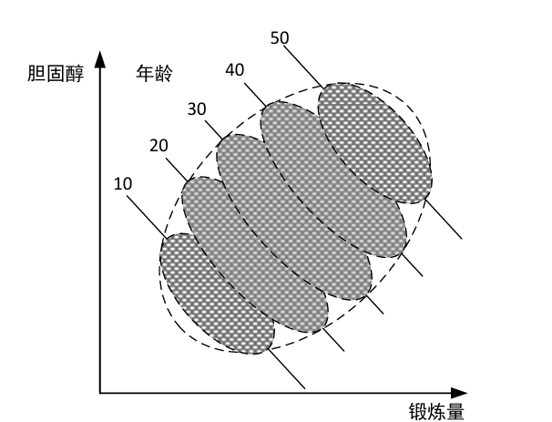</td>
    <td align="center">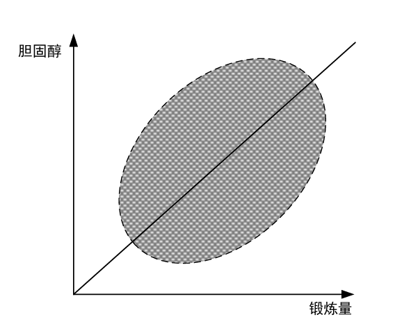</td>
  </tr>
  <tr>
    <td align="center">图1</td>
    <td align="center">图2</td>
  </tr>
</table>

怎么回事呢？  
存在一种类型的数据，当我们从不同的角度分析的时候，我们会得出不同的结论。这就是著名的辛普森悖论：
> 在分组数据中每个子组都呈现同一种趋势，但把这些组合并成总体后，趋势却消失甚至反转。

在这个例子里面，年轻人无论运动量大小，胆固醇水平都比较低，老年人无论运动量大小，胆固醇水平都比较高。而且年轻人花在运动上面的时间会少于老年人。我们发现，年龄既影响了胆固醇水平，又影响了锻炼量，如果数据里面没有年龄相关的信息，那肯定就是计算不出来运动量对于胆固醇水平的真实影响。在这里，年龄被认为是产生辛普森悖论的**混杂因子**

> 一般来说，当一个变量同时影响到原因变量和结果变量时，这个变量被称为混杂因子。

在这个例子里面，为了计算锻炼量对胆固醇水平的真实影响，我们首先需要考虑年龄这个混杂因子，然后把研究对象按照年龄进行分组，从而保证每个分组内的研究对象所有方面（除了每周锻炼量）都相同或相似，其次评估每个年龄组中同龄人的每周锻炼量对胆固醇水平的影响，最后对所有分组的结果进行加权求平均，这样就不会得出锻炼量大的人其胆固醇水平反而升高这样的错误结论了。  

在一般情况下，计算原因变量对结果变量的因果效应时，如果混杂因子未被识别和控制，估计结果就会包含混杂偏差，从而得到**有偏的因果效应估计**，甚至可能把效应的方向判断反（辛普森悖论）。  

因此，**识别并控制混杂因子**是校正混杂偏差的关键。在运动量与胆固醇的例子中，年龄是混杂因子。但判断一个变量是否为混杂因子并不容易——**仅凭观测数据往往无法唯一确定**。混杂因子的识别与混杂偏差的修正（即混杂问题），一直是因果推断领域的核心研究问题之一。  

为解决实践问题中的因果关系推断问题，研究者分别从**试验性研究方法**和**数据驱动的研究方法**两个角度提出了相应的因果关系推断模型与方法。

## 1.3随机对照试验
**随机对照试验**是因果关系推断的**试验性研究方法**，由统计学家费舍尔提出，被公认为因果关系推断的黄金法则。  

> 随机对照试验的主要目的是采用**人工主动干预**的方式消除混杂因子对因果效应评估的影响，是**真正的人为实施的控制与干预操作**，观测由此引起的事物或现象的变化来推断变量之间的因果关系。

研究人员测试一种药物的治疗效应，研究人员随机地把志愿者分成两组，其中的一组称为处理组，另一组称为对照组。  
处理组的志愿者服用药物，对照组的志愿者不服用药物（或安慰剂），最后研究人员通过比较处理组和对照组的治疗效果的差异，获得最终的药物的治疗效应。  
在理想情况下，每个志愿者将被随机分配到处理组或对照组，随机分配机制保证了处理组和对照组在所有方面尽量
相同或相似，通过这种方式使得混杂因子（体质、性别、年龄等）失效，从而达到消除混杂偏差的目的。  

但是多数情况下，由于随机试验法代价高，或者其他客观条件、道德伦理等因素的限制，随机对照试验并**不具有可行性**。  

随着数据收集手段的提高，研究人员收集了大量的观测数据，在随机对照试验不可行的情况下，研究人员试图**在不需要真正实施人为干预的情况下，直接从观测数据中推断因果关系**。这已经成为因果推断领域的主流研究方向。  

## 1.4数据驱动的因果推断模型
接着前面，为了能够利用观测数据进行因果关系推断，研究者们开发了**数据驱动的因果推断模型**，其中最为著名的是**潜在结果模型**与**结构因果图模型**。  
社会科学、计量经济学、流行病学等领域主要采用潜在结果模型，而人工智能与计算机领域更多地采用结构因果模型。  

**潜在结果模型**由哈佛大学著名统计学家Donald Rubin教授提出，是因果关系推断最重要的理论模型之一。潜在结果模型研究的核心问题是**混杂变量的控制**。  
潜在结果模型主要**在“可交换性/可忽略性”假设下，保证处理组和对照组的可比性或同质性，以实现对混杂因子进行控制和混杂偏差修正。**  
“可交换性”假设要求对照组在干预或不干预情况下的结果和处理组在同样的干预或不干预情况下的结果保持一致，保证处理组和对照组在所有方面尽可能相同或相似。  

**结构因果模型**由图灵奖获得者Judea Pearl教授提出，是贝叶斯网络模型的延伸和扩展。  
结构因果模型通过**因果图（有向无环图）**与**赋值方程**表示因果关系。  
**因果图是因果关系的图形化定性表示，而赋值方程是因果关系的定量表示。**  
结构因果模型可以表示多维复杂变量之间的因果关系。Pearl结合结构因果模型与do演算发展了一套完整的理论与方法来识别混杂因子和修正混杂偏差。  
结构因果模型的核心是因果图，有向无环图是因果图的主要表示模型。基于有向无环图，Pearl给出了混杂因子一般化和图形化的定义，利用有向无环图（因果结构）学习算法，Pearl解决了数据驱动的因果效应计算中的混杂因子的识别问题。因此，如何从数据中学习因果结构（有向无环图）是结构因果模型实现因果效应评估的关键。

## 1.5图模型
### 1.5.1有向无环图
关于图的基本概念大家想必在离散数学中都已经有了一定的了解。此处不再赘述。  
> 一个没有环的有向图称为有向无环图（DAG）

如图3，就是一个有向无环图。  

  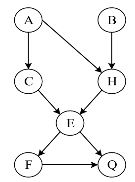

图3

**有向无环图是因果关系表示的最重要的图模型**。  

如果赋予有向无环图中的有向边因果语义，即如果存在有向边 $V_i\to V_j$，则称 $V_i$ 是 $V_j$ 的直接原因，$V_j$ 是 $V_i$ 的直接结果，那么有向无环图被称为**因果图**或**因果结构**。  

有向无环图由三种基本结构组成：链结构、叉结构、对撞结构（V结构）。  

<table>
  <tr>
    <td align="center">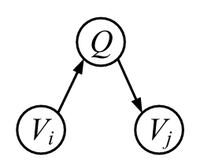</td>
    <td align="center">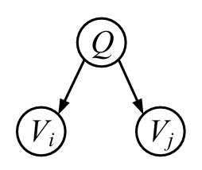</td>
    <td align="center">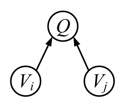</td>
  </tr>
  <tr>
    <td align="center">（a）链结构</td>
    <td align="center">（b）叉结构</td>
    <td align="center">（c）对撞结构</td>
  </tr>
</table>

图4　有向无环图的三种基本结构

了解了这三种基本结构后，我们将开始介绍有向无环图中的重要概念：**d-分离**。

> 定义1-1 阻断路径  
> 在有向无环图 $G$ 中，如果以下两个条件满足任意一个，则节点 $V_i$ 与 $V_j$ 之间的一条路径 $p$ 被条件集 $\mathcal{Z}$（可能为空集）阻断：  
> （1）路径 $p$ 中存在链结构 $V_i\to Q\to V_j$ 或叉结构 $V_i\leftarrow Q\to V_j$，且 $Q$ 在 $\mathcal{Z}$ 中；  
> （2）路径 $p$ 中存在对撞结构 $V_i\to Q\leftarrow V_j$，且 $Q$ 的子孙节点都不在 $\mathcal{Z}$ 中。

> 定义1-2 d-分离（有向分割）  
> 如果两个节点 $V_i$ 与 $V_j$ 之间的所有路径都被集合 $\mathcal{Z}$ 阻断，则 $V_i$ 与 $V_j$ 被集合 $\mathcal{Z}$“d-分离”。  

如果 $V_i$ 与 $V_j$ 之间存在一条路径没有被集合 $\mathcal{Z}$ 阻断，那么 $V_i$ 与 $V_j$ 被“d-连接”。  

图5是一个有向无环图，我们将借助它来演示上面的相关概念。  

  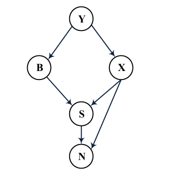

图5

先看路径 $B\to S\leftarrow X$，它在 $S$ 处构成对撞结构，$S$ 是对撞节点。根据定义1-1的第（2）条，只要 $S$ 及其子孙节点都不在 $\mathcal{Z}$ 中，这条路径就被 $\mathcal{Z}$ 阻断，条件集 $\mathcal{Z}$ 为空集就是最简单的情形。  
再看路径 $B\leftarrow Y\to X$，它在 $Y$ 处构成叉结构，$Y$ 是分叉节点。取 $\mathcal{Z}=\{Y\}$，路径即被 $Y$ 阻断。  
链结构的判断同理：路径 $Y\to B\to S$ 和 $Y\to X\to S$ 的中间节点分别是 $B$ 和 $X$，因此取 $\mathcal{Z}=\{B\}$ 和 $\mathcal{Z}=\{X\}$ 时，两条路径分别被 $B$ 和 $X$ 阻断。  
最后看路径 $Y\to X\to N\leftarrow S$，它在 $N$ 处构成对撞结构，而 $X$ 是路径上的链节点。这条路径有两个阻断位置：一是 $X$，取 $\mathcal{Z}=\{X\}$ 或 $\mathcal{Z}=\{X,N\}$ 时，路径被 $X$ 阻断；二是对撞节点 $N$，当 $\mathcal{Z}=\varnothing$（$N$ 及其子孙节点都不在 $\mathcal{Z}$ 中）时，路径被 $N$ 阻断。  

接下来分别考察 $X$ 与 $B$、$B$ 与 $N$ 之间的路径。  
$X$ 和 $B$ 之间共有三条路径：
（1）$B\leftarrow Y\to X$；  
（2）$B\to S\leftarrow X$；  
（3）$B\to S\to N\leftarrow X$。  
取条件集 $\mathcal{Z}=\{Y\}$：  
路径（1）在叉节点 $Y$ 处被阻断；路径（2）的对撞节点是 $S$，路径（3）的对撞节点是 $N$，而 $S$、$N$ 及其子孙节点都不在 $\mathcal{Z}$ 中，因此这两条路径也被阻断。  
三条路径全部被阻断，故 $X$ 与 $B$ 被集合 $\{Y\}$“d-分离”。  

$B$ 和 $N$ 之间共有四条路径：  
（1）$B\leftarrow Y\to X\to S\to N$；  
（2）$B\leftarrow Y\to X\to N$；  
（3）$B\to S\to N$；  
（4）$B\to S\leftarrow X\to N$。  
路径（1）上的 $Y$、$X$、$S$，路径（2）上的 $Y$、$X$，以及路径（4）上的 $X$ 都是非对撞节点，条件集 $\mathcal{Z}$ 只要包含其中任意一个，该路径即被阻断；路径（3）的中间节点是 $S$，$\mathcal{Z}$ 包含 $S$ 时即被阻断。路径（4）在 $S$ 处还构成对撞结构，当 $\mathcal{Z}$ 不含 $S$ 及其子孙节点时（如 $\mathcal{Z}=\varnothing$），也可在对撞节点处被阻断。  
综合四条路径的阻断条件，取 $\mathcal{Z}=\{S,X\}$：路径（1）、（2）在 $X$ 处被阻断，路径（3）在 $S$ 处被阻断，路径（4）在 $X$ 处被阻断。四条路径全部被阻断，因此 $B$ 与 $N$ 被集合 $\{S,X\}$“d-分离”。  

在上面，我们发现，实际的路径很有可能不是只有三个节点的路径，而是长路径。在判定长路径时：  
1. 从头到尾拆成连续三元组
2. 逐个判断是链/叉还是对撞
3. 链、叉看中间节点是否 $\in\mathcal{Z}$；对撞看中间节点及其子孙是否都不在 $\mathcal{Z}$
4. 命中任意一个，"阻断"条件即成立——不再看其他节点

### 1.5.2最大祖先图
下面给出一组定义。  
> 定义1.3 因果充分性  
> 当观测变量集 $\mathcal{V}$ 中任意两个或多个变量的直接原因都存在 $\mathcal{V}$ 中时，则 $\mathcal{V}$ 满足因果充分性假设。  

> 定义1.4 混合图  
> 混合图由三种基本类型的边组成：有向边（$\to$ 或 $\leftarrow$）、双向边（$\leftrightarrow$）和无向边（$-$）。  

> 定义1.5 祖先图  
> 如果一个混合图满足下列条件，则该混合图被称为祖先图。  
> （1）混合图中不存在有向环；  
> （2）混合图中不存在几乎有向环；  
> （3）对于任意的无向边 $V_i-V_j$，$V_i$ 和 $V_j$ 在混合图中不存在父节点和配偶节点。  

> 定义1.6 对撞节点和非对撞节点  
> 在祖先图中，给定一条路径 $\pi$ 和节点 $V_i$，如果 $\pi$ 存在 $\ast\to V_i\leftarrow\ast$（其中 $\ast$ 表示任意的边缘标记 $\to$ 或 $-$），则称 $V_i$ 为对撞节点；否则称 $V_i$ 为非对撞节点。  

> 定义1.7 对撞结构或V结构  
> 在祖先图中，给定三元组 $\{V_i,V_j,V_k\}$，如果 $V_i$ 和 $V_j$ 是邻接的，$V_j$ 和 $V_k$ 是邻接的，但是 $V_i$ 和 $V_k$ 不是邻接的，则称该三元组构成非封闭的三元组。  
> 在一个非封闭的三元组 $\{V_i,V_j,V_k\}$ 中，如果 $V_j$ 是对撞节点且 $\exists\mathcal{Z}\subseteq\mathcal{V}\setminus\{V_i,V_j,V_k\}$，使得 $V_i\perp V_k\mid\mathcal{Z}$，且 $\neg(V_i\perp V_k\mid\mathcal{Z}\cup\{V_j\})$，则三元组 $\{V_i,V_j,V_k\}$ 构成 V 结构。  

> 定义1.8 m-分离（m-separation）  
> 在祖先图中，给定一条路径 $\pi$，如果条件集 $\mathcal{Z}$ 满足如下两个条件中的一个，则 $\pi$ 被 $\mathcal{Z}$ 阻断。  
> （1）$\pi$ 中存在一条子路径 $\{V_i,V_j,V_k\}$，$V_j$ 是一个非对撞节点且 $V_j\in\mathcal{Z}$；  
> （2）$\pi$ 中存在 $V_i\ast\to V_j\leftarrow\ast V_k$，$V_j\notin\mathcal{Z}$ 且 $\mathcal{Z}$ 中不存在 $V_j$ 的子孙节点。  

有了以上的知识储备后，我们来看一个问题。  
当观测数据中出现未观测到的**隐变量**时，有向无环图将难以有效表示这些隐变量。  

  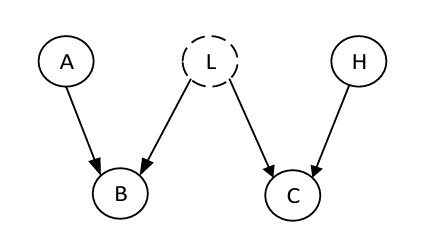

图6

图6中，$A$、$B$、$C$、$H$ 是四个可观测变量，$L$ 是不可观测的**隐变量**。  
$A$ 与 $H$ 之间只有一条路径 $A\to B\leftarrow L\to C\leftarrow H$，路径上 $B$ 和 $C$ 都是对撞节点，$L$ 是非对撞节点。  

根据定义1-1，取不同的条件集：  
$\mathcal{Z}=\varnothing$ 时，$B$、$C$ 两个对撞节点都未被条件化，路径被阻断；  
取 $\mathcal{Z}=\{B\}$ 时，$B$ 被打开，但 $C$ 未被条件化，路径仍在 $C$ 处被阻断；  
取 $\mathcal{Z}=\{C\}$ 时对称，路径在 $B$ 处被阻断；  
只有取 $\mathcal{Z}=\{B,C\}$ 时，两个对撞节点同时被条件化，整条路径被打开，$A$ 与 $H$ 之间才产生关联。  

由此得到三条关系：$A\perp H\mid B$、$A\perp H\mid C$ 和 $\neg(A\perp H\mid\{B,C\})$  
前两条是条件独立，第三条是条件依赖。  
也就是说，单独控制 $B$ 或单独控制 $C$ 都不会引入偏差，但**同时控制两个对撞节点，反而会让 $A$ 与 $H$ 之间凭空出现虚假关联**。  

**这三条关系无法用任何一个以 $A$、$B$、$C$、$H$ 为节点的有向无环图表示**。  
要让同一条路径在给定 $B$ 或 $C$ 时都被阻断，却在给定 $\{B,C\}$ 时被打开，路径上就必须同时有被 $B$ 打开的对撞节点和被 $C$ 打开的对撞节点。在这四个变量构成的 DAG 中，$A$ 到 $H$ 的路径内部节点只能是 $B$ 和 $C$，于是要求 $B$ 和 $C$ 都是对撞节点；但 $B$ 与 $C$ 之间的边只能有一个方向，不可能同时指向两端，因此**这样的有向无环图不存在**。  

Richardson等提出了最大祖先图（MAG）模型。最大祖先图在有隐变量情况下具有表示观测变量之间关系的能力。  

> 定义1.9 最大祖先图  
>  如果一个祖先图 $G$ 满足条件：
> 对于图中每对不邻接的节点 $X$ 和 $Y$ 存在一个集合 $\mathcal{Z}$，使得 $X$ 和 $Y$ 在 $\mathcal{Z}$ 上是 m-分离的，则称该祖先图 $G$ 为最大祖先图。 

最大祖先图
图7是图6所对应的最大祖先图。  

  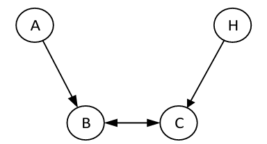

图7　图6所对应的最大祖先图

我们不得不提问，**最大祖先图为何能表示观测变量间的关系**？  
最大祖先图并非简单删除隐变量，而是把隐变量的作用**投影**到观测变量之间的边上，再以 m-分离取代 d-分离。
1. **隐变量的问题**：隐变量无法观测、无法画进图；直接删掉它，由它造成的关联也会消失——图 6 中删去 $L$，$B$ 与 $C$ 之间就再无联系。
2. **MAG 的做法**：用双向边 $\leftrightarrow$ 表示两个观测变量共同受某个隐变量影响（混杂），用有向边 $\to$ 表示二者的因果方向。图 6 中的 $L$ 被 $B\leftrightarrow C$ 吸收，得到图 7：$A\to B\leftrightarrow C\leftarrow H$。
3. **关系为何没有丢失**：MAG 的 m-分离把 $\leftrightarrow$ 的两端都视为箭头，因此 $B$、$C$ 在图 7 的路径 $A\to B\leftrightarrow C\leftarrow H$ 上都是对撞点——$\mathcal{Z}=\varnothing$、$\{B\}$、$\{C\}$ 时路径被阻断，$\mathcal{Z}=\{B,C\}$ 时被打开，**与图6推出的三条关系完全一致**。
4. **"最大"的作用**：最大性保证每对不邻接的变量都能被某个集合 m-分离，即**缺失的边恰好对应真实的条件独立**，图的表达既不多也不少。

DAG中存在等价类，即等价类满足同样的条件独立性和具有相同的对撞结构。  
隐变量和观测变量的独立性关系可能与多个MAG一致。MAG的等价类由**部分祖先图**表示。

> 定义1.10 部分祖先图（PAG）  
> 在一个 PAG 中，一条边的两端可能有三种类型端点：
> （1）不变箭头，记为“$>$”，表示等价类中的所有 MAG 在该端点处有一个箭头；
> （2）不变尾部，记为“$-$”，表示等价类中的所有 MAG 在该端点处都有一个尾部；
> （3）可变端点，记为“$o$”，表示等价类中的某些 MAG 在该端点处有箭头，而其它 MAG在该端点处有一个尾部。
<table align="center">
  <tr>
    <td align="center">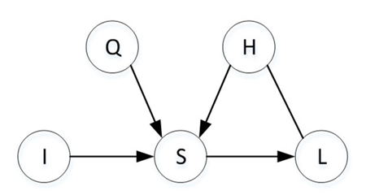</td>
    <td align="center">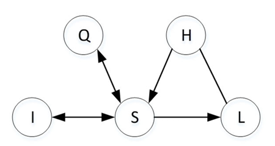</td>
    <td align="center">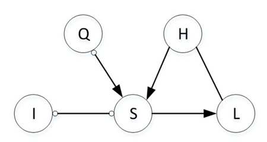</td>
  </tr>
  <tr>
    <td align="center">图8-a</td>
    <td align="center">图8-b</td>
    <td align="center">图8-c</td>
  </tr>
</table>

图8-a，图8-b都是部分祖先图8-c的等价类最大祖先图。

## 1.6贝叶斯网络
首先给出贝叶斯网络中的**马尔可夫假设**：
> 定义1.11 马尔可夫假设  
> 在图 $G$ 中，对于任意的节点 $V_i\in\mathcal{V}$，在给定其父节点的条件下，$V_i$ 和它的非子孙节点条件独立。  

> 定义1.12 贝叶斯网络  
> 如果三元组 $\langle\mathcal{V},G,P(\mathcal{V})\rangle$ 满足马尔可夫假设，则称三元组 $\langle\mathcal{V},G,P(\mathcal{V})\rangle$ 为贝叶斯网络。

贝叶斯网络由有向无环图 $G$ 和一个联合概率分布 $P(\mathcal{V})$ 构成。一个满足马尔可夫假设的贝叶斯网络蕴含了一系列条件独立性假设，变量间的依赖/独立性关系可以由一个仅包含有向边的有向无环图 $G$ 表示出来。  

贝叶斯网络的核心是有向无环图 $G$，其节点为实践中的随机变量（属性或特征）。

根据马尔可夫假设，贝叶斯网络所蕴含的条件独立性关系可将联合概率分布 $P(\mathcal{V})$ 分解为：

$$P(\mathcal{V})=\prod_{i=1}^{N}P\big(V_i\mid \mathcal{Pa}(V_i)\big) \tag{1-1}$$

其中 $\mathcal{Pa}(V_i)$ 表示节点 $V_i$ 的所有父节点集合。式1-1表示贝叶斯网络所蕴含的条件独立性假设将分布 $P(\mathcal{V})$ 分解成**一系列局部的条件概率分布**，这是一个**复杂高维概率分布的低维表示**。  
式1-1中，每个局部概率因子表示一个变量在网络中给定父节点时的条件概率。  
因此，贝叶斯网络利用有向无环图和马尔可夫假设，将一个高维的概率分布估计问题转化为低维的局部概率分布估计问题。  

如图9所示的贝叶斯网络由四个节点构成的有向无环图和相应的条件概率表构成。其中所示的贝叶斯网络的四个节点的联合概率分布，由每个节点与它的父节点构成的局部概率分布表示。

  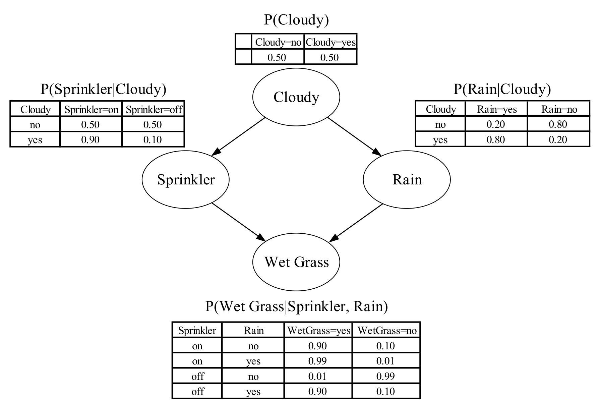

图9　一个简单的带有条件概率分布表的贝叶斯网络

下面需要介绍的是**贝叶斯网络如何利用有向无环图和马尔可夫假设分解一个高维的联合概率分布**。  

对于定义在 $N$ 个二元随机变量上的联合分布 $P(\mathcal{V})=P(V_1,V_2,\dots,V_N)$，确定这个分布需要 $2^N-1$ 个独立参数，因此直接计算联合概率分布 $P(\mathcal{V})$ 相当困难。  
假定 $(V_1,V_2,\dots,V_N)$ 是 $\mathcal{V}$ 中的变量相对于有向无环图 $G$ 的一个拓扑序列，一般使用概率的链式法则可以把 $P(\mathcal{V})$ 进行如下分解：

$$P(V_1,\dots,V_N)=P(V_1)\prod_{i=2}^{N}P(V_i\mid V_1,\dots,V_{i-1}) \tag{1-2}$$

当 $N$ 较大时，式1-2仍然很难计算。根据式1-1，假设每个节点在图 $G$ 中最多有 $k$ 个父节点，那么所需要的独立参数的个数将少于 $N\cdot 2^{k}$。  
在很多实际应用中，$k$ 往往远小于 $N$，使得贝叶斯网络中的参数个数指数级地小于联合分布参数的个数。  
例如，对于式1-2中的概率因子 $P(V_i\mid V_1,\dots,V_{i-1})$，如果所有 $V_i$ 的父节点都在集合 $\{V_1,\dots,V_{i-1}\}$ 中，此外该集合中不存在 $V_i$ 的子孙节点，且 $\mathcal{An}(V_i)$ 为 $V_i$ 的祖先节点集，即 $\{V_1,\dots,V_{i-1}\}=\mathcal{Pa}(V_i)\cup\mathcal{An}(V_i)$。根据马尔可夫假设：

$$P\big(V_i\mid \mathcal{An}(V_i),\mathcal{Pa}(V_i)\big)=P\big(V_i\mid \mathcal{Pa}(V_i)\big),\quad\text{即}\quad V_i\perp\mathcal{An}(V_i)\mid\mathcal{Pa}(V_i)$$

因此，联合概率分布 $P(\mathcal{V})$ 可分解写成式1-1。

例如，图10中贝叶斯网络的联合概率分布 $P(X,Y,Z,W)=P(X)P(Y\mid X)P(Z\mid Y)P(W\mid Z)$。对于离散数据，我们不需要创建一张联合概率表，只需为四个局部概率分布 $P(X)$、$P(Y\mid X)$、$P(Z\mid Y)$、$P(W\mid Z)$ 创建四张条件概率表，如图10所示。

  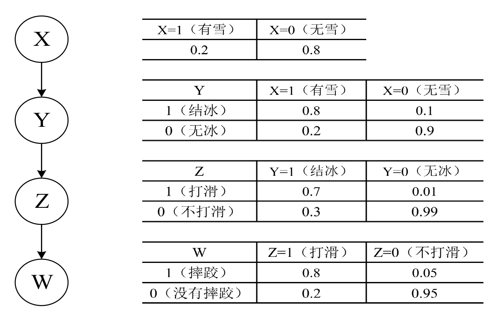

图10　利用贝叶斯网络和式(1-1)估算联合概率分布的例子

图10是一个四节点的贝叶斯网络：令 $X$ 代表 有雪/无雪，$Y$ 代表 路面结冰/路面无冰，$Z$ 代表 路面打滑/路面不打滑，$W$ 代表 摔跤/没有摔跤。  
虽然只有四个变量，但根据人类的经验直接估计 $P(\text{无雪},\text{路面无冰},\text{路面打滑},\text{摔跤})$ 的概率仍然比较困难。  
根据马尔可夫假设，它可以分解为 $P(\text{无雪})、P(\text{路面无冰}\mid\text{无雪})、P(\text{路面打滑}\mid\text{路面无冰})、P(\text{摔跤}\mid\text{路面打滑})$ 四个局部概率。根据天气常识，$P(\text{无雪})$ 的概率比较高，如图中的0.8；$P(\text{路面无冰}\mid\text{无雪})$ 也相当高，如图中的0.9；$P(\text{路面打滑}\mid\text{路面无冰})$ 很小，如图中的0.01；而 $P(\text{摔跤}\mid\text{路面打滑})$ 应该很高，如图中的 0.8。于是根据这些数据，可以估算

$$P(\text{无雪},\text{路面无冰},\text{路面打滑},\text{摔跤})\approx 0.8\times 0.9\times 0.01\times 0.8=0.00576$$

这样计算起来就会简化很多。

图模型中的 d-分离是一个纯图论概念，只看图$G$的节点、边和路径。数据分布中的条件独立性是概率概念，它是联合分布$P(\mathcal{V})$的性质，可以用于数据检验。两者是不同的概念。  
马尔可夫假设已经给出了图 $\rightarrow$ 数据的方向，那么如何实现数据 $\rightarrow$ 图的方向呢？  
下面介绍贝叶斯网络中另一个重要假设：**忠实性假设**。

> 定义1.13 忠实性假设  
> 给定一个贝叶斯网络 $\langle \mathcal{V}, G, P(\mathcal{V})\rangle$，对于 $\mathcal{V}$ 中任意两个节点 $V_i$ 和 $V_j$，以及 $\mathcal{Z}\subseteq \mathcal{V}\setminus\{V_i,V_j\}$，如果给定条件集 $\mathcal{Z}$ 时，$V_i$ 和 $V_j$ 条件独立与 $V_i$ 和 $V_j$ 在 $G$ 中被 $\mathcal{Z}$“d-分离”一一对应，即 $X\perp_G Y\mid \mathcal{Z}$ 与 $X\perp_P Y\mid \mathcal{Z}$ 相互等价，则称 $P(\mathcal{V})$ 忠实于 $G$，同时 $G$ 忠实于 $P(\mathcal{V})$。

在定义1.13中，符号 $X\perp_G Y\mid \mathcal{Z}$ 表示在给定 $\mathcal{Z}$ 的条件下，$X$ 与 $Y$ 在图 $G$ 中被 d-分离；符号 $X\perp_P Y\mid \mathcal{Z}$ 表示在给定 $\mathcal{Z}$ 的条件下，$X$ 与 $Y$ 在分布 $P(\mathcal{V})$ 上条件独立。

忠实性假设使得图模型中的 d-分离与数据分布中的条件独立性相互等价。因此，这个假设使我们可以从数据集中学习产生这个数据集的图模型成为可能。  
**d-分离蕴含着图模型背后的数据生成机制，即数据中蕴含的条件独立性关系**。  

如果数据 $D$ 由图 $G$ 生成，d-分离将告诉我们数据 $D$ 中的哪些变量在哪些变量的条件下是条件独立关系；同时，我们也可以从数据 $D$ 中利用条件独立性检验方法，检验图 $G$ 中哪些变量在哪些变量的条件下是 d-分离关系。  
图 $G$ 作为数据 $D$ 的生成机制，如果 $G$ 中的两个变量 $X$ 和 $Y$ 被变量 $Z$“d-分离”，那么在数据 $D$ 中给定 $Z$，$X$ 和 $Y$ 应该条件独立；如果 $X$ 和 $Y$ 条件独立不成立，那么数据 $D$ 不是由图 $G$ 生成。  
因此，如果图 $G$ 中的所有 d-分离条件均与数据 $D$ 中的条件独立性一致，那么可以认为**图 $G$ 精确地生成了数据 $D$**。

这样不仅使我们可以从一个图模型出发生成一个数据集，也可以从一个数据集出发反推出因果图模型。这是数据驱动的因果结构学习方法奏效的关键。

贝叶斯网络与结构因果模型都是在贝叶斯网络理论基础发展与演化而来的，因此贝叶斯网络的所有概率性质，还有在其基础上发展起来的概率推理算法，在因果关系推理与因果效应计算中仍然有效。  

贝叶斯网络的概率推理任务是：  
在给定一个变量集合 $\mathcal{Z}$ 的观测值（证据）时，计算出另一个被查询的变量集合 $\mathcal{Q}$ 的后验概率分布，即条件概率查询 $P(\mathcal{Q}\mid \mathcal{Z})$。  

例如，在图9中，查询在已知 Cloudy 取值时 WetGrass=no 的后验概率，就是一个条件概率查询。

给定一个贝叶斯网络，研究者提出了一系列条件概率查询算法。  

变量消元法是一个经典的贝叶斯网络概率推理算法，绝大多数的概率推理算法都是变量消元法的推广和发展，例如桶消元法和联合树算法。  
变量消元法利用贝叶斯网络联合概率分布的模块化性质，将联合概率分布分解为每个节点给定其父节点的条件概率的乘积，然后通过改变求和与乘积运算的次序对联合概率分布的变量进行边缘化，实现联合分布中的变量消除。我们通过图11给出一个消元推理的例子：求解 $P(J,Y,M)$ 的联合概率，需要对联合概率分布公式中的变量 $C$、$Z$、$L$ 进行求和，从而实现消元，如式1-3所示。

  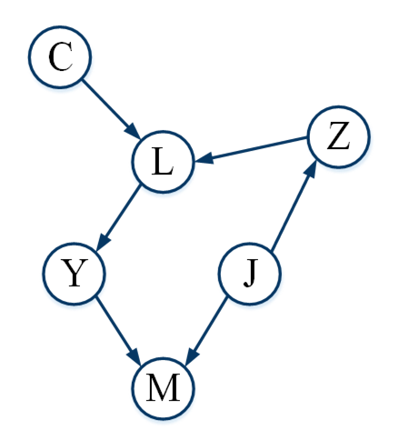

图11　贝叶斯网络与消元推理

根据图11和式1-1，可得联合概率分布公式1-3：

$$P(C,Z,L,J,Y,M)=P(C)P(Z\mid J)P(L\mid C,Z)P(J)P(Y\mid L)P(M\mid Y,J) \tag{1-3}$$

对于条件概率分布 $P(J\mid M,Y)$，根据贝叶斯法则可得

$$P(J\mid M,Y)=\frac{P(J,M,Y)}{P(M,Y)} \tag{1-4}$$

$\mathcal{Z}$ 表示除 $J$、$Y$、$M$ 的所有变量。根据图11和贝叶斯网络联合概率分布，对于条件概率分布 $P(J\mid M,Y)$，消元推理算法的计算公式如下：

$$P(J\mid M,Y)=\frac{P(J,M,Y)}{P(M,Y)}=\frac{\sum_{C,Z,L}P(C)P(Z\mid J)P(L\mid C,Z)P(J)P(Y\mid L)P(M\mid Y,J)}{\sum_{C,Z,L,J}P(C)P(Z\mid J)P(L\mid C,Z)P(J)P(Y\mid L)P(M\mid Y,J)} \tag{1-5}$$
